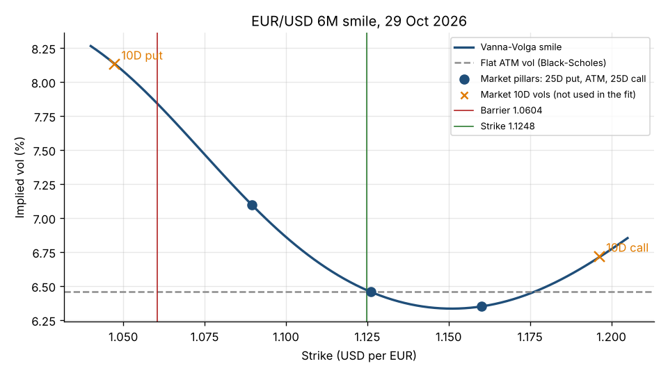
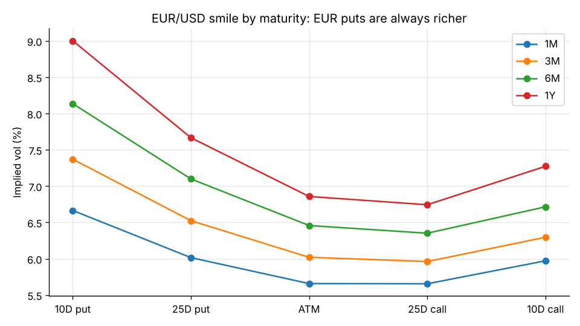
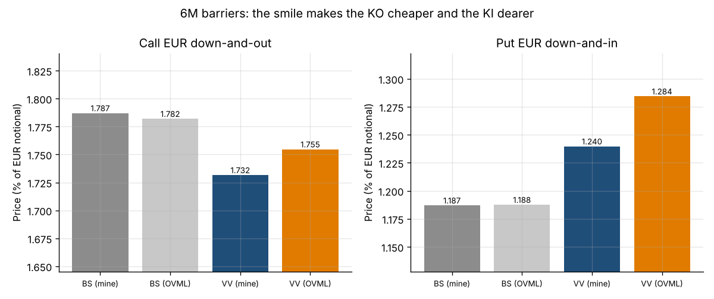
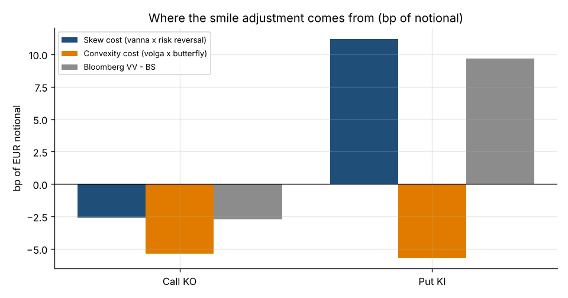
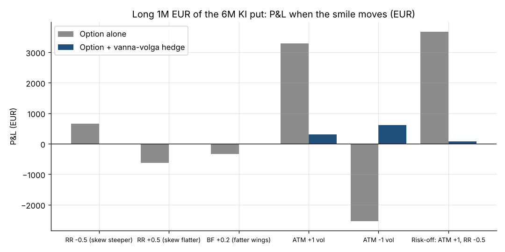

# Pricing EUR/USD Barrier Options on the Smile (Vanna-Volga vs Bloomberg)

A barrier option is a bet on the **shape** of the volatility smile, not only on its
level. Black-Scholes uses one volatility for every strike, so it cannot see that shape,
and it misprices barriers. FX desks fix this with the **Vanna-Volga** method: an exotic
should cost what it costs to hedge its smile risk with three liquid vanilla options.

In this project I build the EUR/USD smile from real Bloomberg quotes of 29 October 2026,
price four 6-month barrier options, and compare my numbers with Bloomberg's own pricer
(OVML). Then I look at it the way a hedge fund would: **what smile risk am I taking when
I buy one of these options, and how do I hedge it?**

**Data.** Bloomberg OVDV (EUR/USD vol surface), FRD (forward points) and four OVML
barrier prices, all taken on 29 Oct 2026 around 15:00 New York. Mid quotes. The files
are in `data/`. Bloomberg data cannot be shared, so `data/*.csv` is in `.gitignore`
and is not pushed to GitHub.



## 1. What the market says on 29 Oct 2026

FX vol is not quoted by strike. It is quoted with three numbers per maturity:

| Quote | What it is | 6M value | Reading |
|---|---|---|---|
| **ATM** | vol of the at-the-money straddle | 6.46% | the general level of vol |
| **25D risk reversal** | vol(25D EUR call) − vol(25D EUR put) | −0.75% | the **skew**: EUR puts are dearer than EUR calls |
| **25D butterfly** | average of the two 25D vols − ATM | +0.27% | the **convexity**: both wings are dearer than ATM |

From these I get the vols of the 25-delta put (7.10%) and the 25-delta call (6.35%).
A negative risk reversal means the market pays more to protect against a **fall of the
euro** than against a rise. This is true for every maturity, and the skew grows with
maturity (−0.36% at 1 month, −0.92% at 1 year).



The forward comes from the Bloomberg forward points (6M: +85.9 pips, so F = 1.1248). The
points are positive because USD rates (4.2%) are above EUR rates (2.6%). I take the USD
deposit rate as given and back out the EUR rate from the forward (covered interest parity).

## 2. Building the smile with Vanna-Volga

**The idea.** Take any option. Compute its vega, vanna and volga with a flat ATM vol.

- **Vega** (dV/dσ): exposure to the level of vol, priced by the ATM straddle.
- **Vanna** (d²V/dS dσ): exposure to the skew, priced by the risk reversal.
- **Volga** (d²V/dσ²): exposure to the convexity, priced by the butterfly.

Find the amounts of three vanillas (25D put strike, ATM, 25D call strike) that have
**the same vega, vanna and volga** as the option. This is a 3×3 linear system. The
Vanna-Volga price is then:

> **VV price = Black-Scholes price at ATM vol + cost of this hedge on the real smile**

The cost of the hedge is simply the market price of each vanilla minus its price at ATM vol.
Applied to every strike, this gives a full smile from three quotes (blue line in the
first chart).

**Three checks against Bloomberg:**

| Check | Mine | Bloomberg |
|---|---|---|
| 1M ATM strike (delta-neutral straddle) | 1.1177 | 1.1177 |
| 1M ATM call price, bid / ask (% USD) | 0.644 / 0.674 | 0.644 / 0.674 |
| 6M 10D put vol (smile built only on 25D quotes) | 8.136% | 8.131% |
| 6M 10D call vol | 6.715% | 6.719% |

The 10-delta vols are a real out-of-sample test: I never use them to build the smile, and
Vanna-Volga still finds them to within 0.5 vol basis points at 6 months (within 4.5 bp at
1 month, see `results/check_10d_wings.csv`).

## 3. The four Bloomberg barrier prices

Two 6-month options on 1M EUR, both with a strike at the forward (ATMF) and a barrier 5%
below spot, monitored continuously:

- a **EUR call, down-and-out** at 1.0604: the call dies if EUR/USD trades at 1.0604;
- a **EUR put, down-and-in** at 1.0605: the put only exists if EUR/USD trades at 1.0605.

| % of EUR notional | Black-Scholes (mine) | Black-Scholes (OVML) | Vanna-Volga (mine) | Vanna-Volga (OVML) |
|---|---|---|---|---|
| Call down-and-out | 1.787 | 1.782 | 1.732 | 1.755 |
| Put down-and-in | 1.187 | 1.188 | 1.240 | 1.284 |
| **Smile effect, call KO** | | | **−5.5 bp** | **−2.7 bp** |
| **Smile effect, put KI** | | | **+5.3 bp** | **+9.7 bp** |



**Black-Scholes matches Bloomberg to within 0.5 bp.** The closed-form barrier formulas
(Reiner-Rubinstein, as written in Haug) and the Greeks are right: delta 49.5% vs 49.4%,
gamma €80,354 vs €80,318, vega €2,613 vs €2,612 for the call KO.

**Vanna-Volga gets the direction right, not the exact level.** The smile makes the
call KO cheaper and the put KI dearer, as in Bloomberg. Why:

- **Put KI:** it only pays if EUR first falls 5%. It is a bet on EUR downside, exactly
  what the negative risk reversal makes expensive. The option is **long vanna**, so the
  skew adds to its price.
- **Call KO:** it dies when EUR falls, so it does not care about the dear EUR puts. Its
  skew exposure is small, and it is **short volga** (more vol means more chance of being
  knocked out), so fat wings make it cheaper.



**Why my numbers differ from Bloomberg by 2 to 4 bp.** Vanna-Volga is a recipe, not a
model, and each bank uses its own weights. I scale the hedge cost of the knock-out by its
probability of survival (78%): the hedge only matters while the option is alive. The
chart above splits the hedge cost in two. The **skew cost alone** (−2.6 bp and +11.2 bp)
is close to Bloomberg's adjustments (−2.7 bp and +9.7 bp). My reading is that Bloomberg
gives a lower weight to the **convexity cost**, which in my version is around −5.5 bp for
both options. The checks on vanillas show that the smile itself is right. The gap comes
from how the smile cost is passed on to a path-dependent option.

**Is a 2–4 bp gap big?** The 6M ATM vol is quoted 6.36 / 6.56, a 0.20 vol spread. With a
vega of about €3,000 on 1M EUR, half the spread is worth about €300, or **3 bp**. So the
difference between my model and Bloomberg's is about one half-spread, while the smile
effect itself (5 to 10 bp) is two to three half-spreads. **Conclusion for a fund: the smile
must be in the price, but a few bp between two Vanna-Volga versions is model noise, not a
trading signal.**

## 4. The fund's view: smile risk and how to hedge it

Suppose the fund **buys the 6M put KI on 1M EUR**: a cheap way to be long EUR downside.
What risk does it hold besides the spot? I bump each market quote by 0.1 vol, reprice
everything on the new smile, and scale to 1 vol point:

| Quote moves by +1 vol pt | P&L on 1M EUR |
|---|---|
| ATM vol | +€3,051 |
| 25D risk reversal (skew less negative) | −€1,276 |
| 25D butterfly (fatter wings) | −€1,694 |

So the fund is long vol, **long skew** (it gains when EUR puts get dearer), and **short
convexity**. A useful check: the vega with the smile (€3,051) is close to the Bloomberg
VV vega (€2,909), and much lower than the Black-Scholes vega (€4,136). Hedging with the
Black-Scholes vega would over-hedge by about 35%.

**The hedge.** I solve for the three vanillas that cancel the ATM, RR and BF risks. On 1M
EUR this gives: sell €1.72M of ATM calls, sell €0.21M of 1.0895 calls (the 25D put strike,
same vol as the put), and buy €0.99M of 1.1601 calls (the 25D call). Spot delta is hedged
separately with spot.



| Scenario (spot unchanged) | Option alone | Option + hedge |
|---|---|---|
| RR −0.5 (skew steeper) | +€662 | €0 |
| RR +0.5 (skew flatter) | −€625 | €0 |
| BF +0.2 (fatter wings) | −€329 | €0 |
| ATM +1 vol | +€3,299 | +€309 |
| ATM −1 vol | −€2,536 | +€616 |
| Risk-off: ATM +1, RR −0.5 | +€3,679 | +€82 |

Skew and convexity moves are fully hedged. What is left on big ATM moves is the
second-order effect (the option's vega changes when vol moves), which the desk would
re-hedge as vol moves. The "risk-off" line is the reason to hold this option: in a
sell-off, EUR/USD vol rises and the skew steepens, and the option gains on both.

## 5. How I would present it in an interview

- *"Black-Scholes prices barriers with one vol. FX desks fix it with Vanna-Volga: price the
  exotic at ATM vol, then add the cost of hedging its vega, vanna and volga with three
  vanillas on the real smile."*
- *"I built the EUR/USD smile from Bloomberg's ATM, 25D RR and 25D BF quotes. It
  reproduces the Bloomberg quick pricer exactly and finds the 10D vols, which I never used,
  to within 0.5 vol bp at 6 months."*
- *"On a 6M down-and-in EUR put, the smile adds about 5 to 10 bp, because the option is
  long skew and EUR puts are dear. On a down-and-out call it takes off 3 to 5 bp. My
  numbers match Bloomberg's in direction, and the level gap is about half a bid-ask."*
- *"As a buyer, I would look at the risk in quotes: €3,000 per vol point of ATM, −€1,300
  per point of risk reversal. The Black-Scholes vega overstates the vol risk by 35%."*

**Questions to expect, with short answers:**

- *Why is the EUR/USD risk reversal negative?* The market pays more for protection against
  a fall of the euro: in a risk-off move, USD is the safe currency and EUR/USD falls while
  vol rises. This is the same spot/vol correlation that makes equity puts expensive.
- *Why weight by survival probability?* Once the knock-out is dead, the hedge is no longer
  needed. Without the weight, Vanna-Volga overstates the smile effect on knock-outs.
- *Limits of Vanna-Volga?* It is a static recipe with no model dynamics, so prices and
  Greeks of path-dependent options depend on the chosen weights. A bank would check it
  against a local-stochastic-vol model.
- *Why not use the Black-Scholes vega for the hedge?* It ignores that a vol move happens
  together with a skew and a convexity. Bumping the market quotes gives the risk in the
  instruments you actually trade.

## 6. Simplifications

- I treat the broker butterfly as a "smile strangle". Strictly, the broker quote is a
  "market strangle", and the two differ when the skew is large.
- Spot delta without premium adjustment for strikes (EUR/USD convention up to 1 year), and
  delta-neutral straddle ATM.
- One flat rate per currency and per maturity (USD deposit given; EUR rate from the
  forward). For the 3M tenor, the USD rate is interpolated between 1M and 6M.
- Settlement lags (spot date, premium date, delivery) are ignored. This explains the
  0.5 bp gap on the Black-Scholes call KO.
- The scenario analysis moves the smile with spot unchanged. Spot delta and gamma are
  hedged with spot, as usual.

## Run it

```bash
pip install -r requirements.txt
python run_analysis.py      # about 5 seconds, writes charts and tables to results/
pytest                      # 7 tests
```

| File | What it does |
|---|---|
| `fxsmile/black_scholes.py` | Garman-Kohlhagen price, delta, strike from delta, vega/vanna/volga |
| `fxsmile/smile.py` | smile from ATM / RR / BF, Vanna-Volga weights and prices |
| `fxsmile/barrier.py` | closed-form barriers, survival probability, Vanna-Volga barrier |
| `fxsmile/market.py` | Bloomberg data of 29 Oct 2026 |
| `run_analysis.py` | the whole study, step by step |

**References.** Castagna & Mercurio (2007), *The Vanna-Volga method for implied
volatilities*, Risk. Wystup (2006), *FX Options and Structured Products*. Bossens, Rayée,
Skantzos & Deelstra (2010), *Vanna-Volga methods applied to FX derivatives*. Haug (2007),
*The Complete Guide to Option Pricing Formulas* (barrier formulas).
